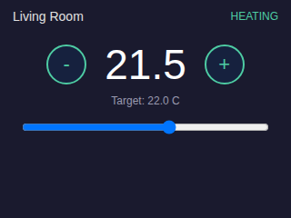
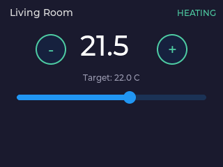
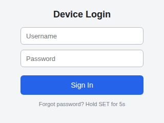
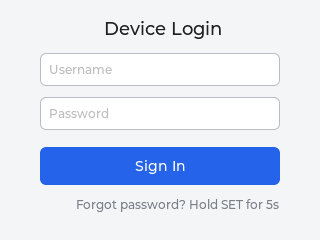
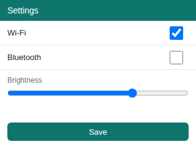
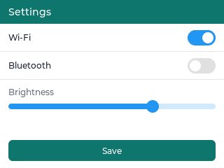

# Phase 0 Spike: HTML → LVGL, End to End

This spike validates the project's core proposed loop:

```text
HTML page ──► headless Chromium ──► UI-tree JSON ──► LVGL XML ──► headless LVGL v9.4 ──► framebuffer PNG
              (extract.mjs:                (convert.mjs)          (render/main.c:
               DOM walk +                                          lv_xml runtime +
               getComputedStyle)                                   virtual display)
```

**Result: the loop works.** Three sample device-UI pages (thermostat card, login form, settings panel) convert automatically into LVGL XML that the stock LVGL v9.4 `lv_xml` runtime instantiates and renders at 320×240 with roughly 90% visual fidelity — well past the "recognizable UI" success bar.

## Side-by-side results

| Page | Chromium (source of truth) | LVGL 9.4 (converted) |
|---|---|---|
| Thermostat |  |  |
| Login |  |  |
| Settings |  |  |

What carried over automatically: background/text/border colors, border radii, absolute geometry from Chromium's layout, font size mapping onto Montserrat, button + centered label composition, slider min/max/value, switch checked state, textarea placeholders and password mode, text alignment, and vertically centered text in decorated bars.

## How to run

```sh
cd spike
npm install                            # Playwright (browsers come pre-installed in CI images,
                                       #  otherwise: npx playwright install chromium)
git clone --depth 1 --branch v9.4.0 https://github.com/lvgl/lvgl.git render/lvgl
cmake -S render -B build -DCMAKE_BUILD_TYPE=Release
cmake --build build -j
./run.sh
```

Outputs land in `out/`: for each page a `<page>.json` (extracted UI tree), `<page>.xml` (generated LVGL XML), `<page>_web.png` (Chromium reference), and `<page>_lvgl.png` (LVGL's actual framebuffer).

## What each piece does

- **`extract.mjs`** — loads the page at 320×240 in headless Chromium, walks the DOM, and records per element: tag, `getBoundingClientRect` geometry, a computed-style subset (colors, border, radius, font size, text-align, padding-left), own text, and form attributes (`type`, `value`, `min`/`max`, `checked`, `placeholder`).
- **`convert.mjs`** — maps the tree to LVGL XML: `button`→`lv_button`+centered `lv_label`, `input[range]`→`lv_slider`, `input[checkbox]`→`lv_switch`, `input[text/password]`→`lv_textarea`, text leaves→`lv_label`, everything else→`lv_obj`. Spike scope uses absolute positioning taken from Chromium's resolved layout (the html-to-figma baseline); flex/grid container mapping is Phase 1 work.
- **`render/`** — a ~150-line C harness: LVGL v9.4.0 with `LV_USE_XML`, a virtual 320×240 ARGB8888 display (no OS, no SDL), `lv_xml_register_component_from_data()` + `lv_xml_create()`, then the framebuffer is written as BMP.
- **`bmp2png.mjs`** — BMP→PNG via Chromium (avoids native image dependencies).

## Findings (feed into Phase 1)

1. **The LVGL XML target works as predicted.** The generated XML is human-readable, hand-editable, and instantiates through stock LVGL with no custom runtime code beyond font registration. Style attributes (`style_bg_color`, `style_radius`, `style_border_*`, `style_text_font`, …) covered everything the spike needed.
2. **Pin LVGL v9.4.0.** During the spike we found the `lv_xml` runtime module was removed from LVGL's `master` branch — XML tooling is consolidating into LVGL Pro (Editor/CLI compile XML to C; the open-source examples now ship XML alongside generated C). v9.4.0 is the last release with the in-tree runtime parser. This confirms pinning a version was the right call and strengthens the case for *also* supporting direct C emission in Phase 2.
3. **Text metrics are the main fidelity gap, as predicted.** Chromium's tight text rects clip when rendered in the wider Montserrat fonts. Two cheap fixes got fidelity from ~75% to ~90%: auto-size plain labels instead of fixing their box, and round CSS `font-size` *down* to the nearest available font. A real converter should measure text with the actual LVGL font metrics at build time.
4. **Duplicate XML attributes are a real emitter bug class.** expat rejects duplicated attributes (`style_pad_all` emitted twice); the Phase 1 emitter should build attribute maps, not strings.
5. **Decorated text blocks need decomposition.** A `<div>` with background + text (the Settings title bar) must become `lv_obj` + child `lv_label` with `align="left_mid"`, not a bare label — browsers vertically center line boxes, LVGL labels don't.
6. **Native form controls map surprisingly well.** Slider geometry (thin track centered in the input's rect), switch checked state, and textarea placeholder/password modes all carried over with trivial mapping code.

## Spike limitations (deliberate, resolved in later phases)

- Absolute positioning only — no flex/grid container mapping yet (Phase 1).
- No images, gradients, shadows, or external CSS-file handling (Phase 2).
- No text measurement with LVGL font metrics; nearest-size Montserrat approximation only.
- Interactivity is not wired: widgets are live (sliders drag, switches toggle) but no event callbacks are generated.
